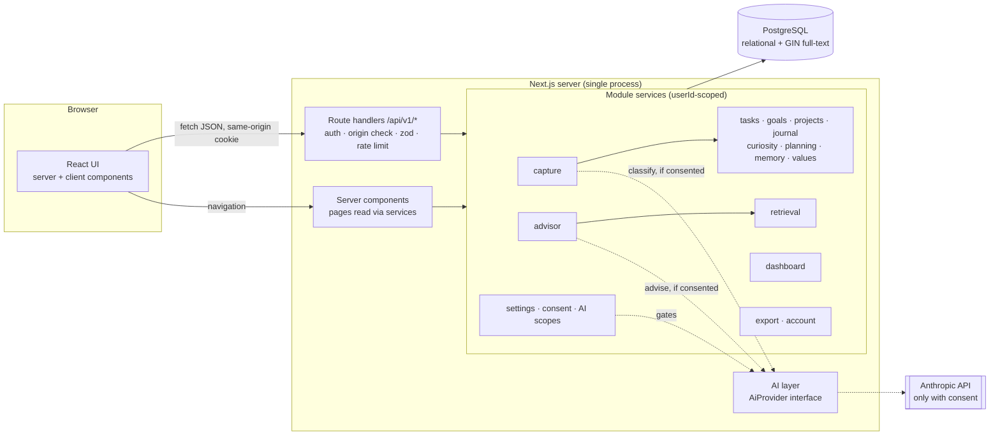

# LIFE OS — Phase 1 implementation blueprint

This document is the Phase 1 plan from section 34 of the product specification,
updated to show what is built. Status markers:
**✅ built and tested** · **◐ partly built** · **○ planned**.

Related documents: [ARCHITECTURE](ARCHITECTURE.md) · [AI_MEMORY](AI_MEMORY.md) ·
[SECURITY](SECURITY.md) · [API](API.md) · [DEPLOYMENT](DEPLOYMENT.md) ·
[DATA_EXPORT](DATA_EXPORT.md)

---

## 1. Architecture (summary)

A **modular monolith**: one Next.js 15 (App Router) application, TypeScript
end to end, PostgreSQL through Prisma. Each product module is a service file
under `src/server/modules/<module>/service.ts`. Services are the only code that
touches the database, and every service function takes the `userId` of the
signed-in user as its first argument. HTTP route handlers and server
components are thin wrappers around them.



Full detail, including the request lifecycle and module boundaries, is in
[ARCHITECTURE.md](ARCHITECTURE.md).

## 2. Repository structure

```
life-os/
├── prisma/
│   ├── schema.prisma          # MVP data model (§3)
│   ├── migrations/            # versioned SQL migrations (incl. hand-written FTS indexes)
│   └── seed.ts                # clearly-labelled SAMPLE account for development
├── src/
│   ├── app/
│   │   ├── (auth)/            # /login, /signup
│   │   ├── onboarding/        # progressive first-run setup
│   │   ├── (app)/             # authenticated screens (shared shell)
│   │   │   ├── page.tsx       # Home / Command Center
│   │   │   ├── today/  life/{goals,journal,identity}/  memory/
│   │   │   ├── projects/  insights/  advisor/  settings/
│   │   └── api/
│   │       ├── auth/{signup,login,logout}
│   │       └── v1/…           # typed JSON API (see docs/API.md)
│   ├── components/            # ui/ primitives, shell/, capture/, feature components
│   ├── lib/                   # shared, framework-free: zod schemas, dates, errors
│   └── server/
│       ├── db.ts  http.ts  audit.ts
│       ├── auth/              # password hashing, sessions, current user
│       ├── security/          # rate limiting
│       ├── ai/                # provider interface, Anthropic provider, prompts
│       └── modules/<module>/  # one service per module
├── tests/
│   ├── unit/                  # pure logic
│   ├── integration/           # services against a real Postgres
│   └── ai-evals/              # model-behaviour cases (opt-in, billed)
├── e2e/                       # Playwright, production build
└── docs/
```

## 3. MVP schema

The schema is in [`prisma/schema.prisma`](../prisma/schema.prisma), with
comments on every non-obvious choice. Tables:

| Area | Tables |
| --- | --- |
| Identity & account | `User`, `Session`, `UserSettings`, `UserConsent` (append-only), `AiDomainPermission` |
| Self-knowledge | `LifeDomain` (8 defaults, renamable, qualitative status), `PersonalValue` |
| Strategy | `Goal` (self-referential hierarchy), `GoalMilestone` |
| Planning | `Project`, `Task`, `DailyPlan`, `DailyPlanItem` (MAIN / OPTIONAL / COMMITMENT / LEISURE / RECOVERY) |
| Reflection & learning | `JournalEntry`, `CuriosityItem` |
| Capture | `Capture` (raw text, classifier, validated proposal, link to the filed record) |
| Memory | `Memory` (layer × epistemic status), `MemorySource` (provenance) |
| Advisor | `AIConversation`, `AIMessage` (stores the context references used) |
| Infrastructure | `AuditLog` |

Deliberate choices:

- **Epistemic status is a column, not a convention.** `Memory.status` is one of
  `USER_STATED`, `IMPORTED`, `AI_INFERENCE`, `USER_CONFIRMED`, `SPECULATIVE`,
  `REJECTED`. It is shown in the UI and attached to every memory placed in a
  prompt.
- **Provenance everywhere.** Records filed from a capture keep `captureId`;
  memories keep `MemorySource` rows.
- **No numeric life scores.** `LifeDomain.status` is self-reported and qualitative
  (`THRIVING`, `STEADY`, `NEEDS_ATTENTION`, `RESTING`, `UNSET`).
- **JSON only where the shape varies.** `Capture.proposal` holds the validated
  proposal, which is re-validated with zod on every read.
- **Soft delete only where Undo is offered** (tasks, goals, projects). Journal
  entries and memories are hard-deleted, along with memories derived only from
  them.
- Entities from §20 of the spec that Phase 1 does not use (health, finance,
  career, relationships, knowledge graph edges, embeddings) are **not** created
  yet. They come with their phase, as migrations, so the schema never carries
  unused tables.

## 4. Screens and navigation

Primary navigation (sidebar on desktop, bottom bar on mobile): **Home · Today ·
Life · Projects · Insights · Advisor**, with **Settings** at the bottom. The
twelve modules sit under these as secondary navigation.

| Screen | Route | Status | Purpose |
| --- | --- | --- | --- |
| Sign in / sign up | `/login`, `/signup` | ✅ | Email and password. Passkeys are planned. |
| Onboarding | `/onboarding` | ✅ | Name, reasons, life areas, priorities, interface density, AI consent and scopes. |
| Home | `/` | ✅ | Date, quick capture, today's focus, energy check-in, items due, life overview, attention panel, inbox, next 7 days, active goals. Minimal / Standard / Analytical modes; recovery-mode variant. |
| Today | `/today?date=` | ✅ | Day planner (intention, energy, main focus, up to 3 optional items, commitments, chosen leisure, recovery), full task list with inline editing. |
| Life overview | `/life` | ✅ | Life areas, each with its own goals. |
| Goals | `/life/goals` | ✅ | Create and inline-edit goals: area, horizon, priority, status, motivation, milestones. |
| Journal | `/life/journal` | ✅ | Optional entries and mood; per-entry "hide from AI"; delete with confirmation. |
| Identity & values | `/life/identity` | ◐ | Values and life areas. Assessments and the dynamic self-model are Phase 2. |
| Memory | `/memory` | ✅ | Everything remembered, grouped by layer, with status badges, "why do you believe this?", confirm / mark inaccurate / hide from AI / edit / delete. |
| Projects | `/projects` | ✅ | Active, ideas and paused columns; kind, purpose, next action, goal link; curiosity inbox. |
| Insights | `/insights` | ◐ | Factual weekly summary: intention vs. what happened, leisure alignment, completions. AI reviews and pattern detection are Phase 2. |
| Advisor | `/advisor` | ✅ | Conversations, six roles, answers grounded in retrieved records with an inspectable "Based on N records" list, honest offline mode. |
| Settings | `/settings` | ✅ | Profile, density, theme, timezone, recovery and quiet mode, AI consent and scopes, signed-in devices, export, account deletion. |
| Command palette | ⌘K | ✅ | Jump anywhere, or send text to quick capture. `/` focuses capture on Home. |

## 5. AI memory and retrieval

Summary (full design in [AI_MEMORY.md](AI_MEMORY.md)):

- **Pipeline, as built for Phase 1:** capture → classify (local rules, or the
  LLM with consent) → *user confirms or edits* → structured storage with
  provenance → retrieval scoped by permissions → grounded answer that cites
  records → user can inspect, correct or delete what was used.
- **Retrieval:** PostgreSQL full-text search (GIN indexes, `simple` dictionary
  so French and English both work) across memories, journal, goals, projects,
  curiosity and tasks, ranked by `ts_rank` × recency, plus a small "core"
  context that is always relevant (values, profile memories, active goals and
  projects, today's plan, tasks due within 7 days). It sits behind one function
  (`retrieveContext`) so pgvector hybrid search can replace it in Phase 2
  without changing callers.
- **Never silently merged:** each memory is labelled in the prompt ("you said",
  "AI inference, unconfirmed", "speculative hypothesis").
- **Exclusions are enforced in SQL:** AI scopes per data type, per-entry and
  per-memory exclusion, rejected memories, and anything `HIGHLY_SENSITIVE`.

## 6. API and service contracts

All endpoints are listed in [API.md](API.md). Conventions:

- JSON in and out. Request bodies are validated by zod schemas from
  `src/lib/schemas/*`, which the client uses too, so validation is shared.
- Errors look like `{ error: { code, message, details? } }`, with `code` one of
  `VALIDATION | UNAUTHENTICATED | FORBIDDEN | NOT_FOUND | CONFLICT | RATE_LIMITED | AI_UNAVAILABLE | INTERNAL`.
- A resource owned by someone else returns **404**, never 403, so the API does
  not reveal that it exists.
- Service contract: `fn(userId, input, extra?, tx?)`. Write services accept an
  optional transaction client, so a capture confirmation creates the record and
  updates the capture atomically.

`AiProvider` (the provider-agnostic contract):

```ts
interface AiProvider {
  readonly id: string;                                          // "anthropic:claude-opus-5-5"
  classify(req: { text; today; weekday }): Promise<AiClassificationOutput>;  // structured output, zod-validated
  advise(req: { system; context; history; question }): Promise<string>;
}
```

## 7. Security model

Summary (full model in [SECURITY.md](SECURITY.md)): scrypt password hashing;
random 256-bit session tokens stored only as SHA-256 hashes; httpOnly SameSite
cookies; sessions can be revoked one by one or all at once; ownership checks in
every service; Origin and content-type checks on mutating requests;
per-user, per-IP and per-account rate limits; a strict CSP and security headers;
an append-only consent log; nothing reaches an LLM without consent and within
the user's scopes; an audit log of security-relevant events; full export and
hard account deletion.

## 8. Prioritised engineering backlog

**Phase 1 — done in this iteration**

1. ✅ Schema, migrations, FTS indexes
2. ✅ Auth: sign-up, login, logout, sessions, revocation, rate limits
3. ✅ Settings, consent log, AI scopes, recovery and quiet mode
4. ✅ Quick capture: rules classifier, AI classifier, editable proposal, confirm / discard, provenance
5. ✅ Tasks, goals and milestones, projects, curiosity, journal, values, life areas
6. ✅ Daily planning with chosen leisure and alignment reflection
7. ✅ Retrieval and advisor with roles, inspectable context, offline mode
8. ✅ Memory screen: explain, confirm, reject, exclude, edit, delete
9. ✅ Dashboard with attention rules and three density modes
10. ✅ Export, account deletion, audit log
11. ✅ Unit, integration, e2e and responsive tests; AI eval cases

**Next (finishing Phase 1)**

12. ○ Passkeys (WebAuthn) and optional TOTP second factor
13. ○ Weekly plan view (§8.6) built on the existing daily plans
14. ○ Streaming advisor responses
15. ○ Redis-backed rate limiting, needed before running more than one instance
16. ○ Encryption at rest for journal bodies and memories (application-level envelope encryption with a KMS key)
17. ○ Automated accessibility checks (axe) in e2e

**Phase 2 — personal intelligence**

18. ○ Embeddings and pgvector hybrid retrieval
19. ○ Memory extraction from journal and conversations, proposed as `AI_INFERENCE` for the user to confirm; deduplication, contradictions, ageing
20. ○ Decision journal and decision reviews
21. ○ Personality assessment import with interpretation and limitations
22. ○ Knowledge-graph edges (goal↔value, project↔goal, observation↔hypothesis)
23. ○ AI weekly review with links to the evidence behind each point
24. ○ Imports (Markdown/CSV/JSON/AI-conversation exports, with role separation)

Phases 3–5 follow the roadmap in the specification.

## 9. Acceptance criteria (MVP features)

Each criterion names the test that checks it.

| Feature | Acceptance criteria | Verified by |
| --- | --- | --- |
| Quick capture | Text is classified into one of 7 destinations; nothing is stored as a record until the user confirms; the user can change the destination and edit fields; low confidence (<0.6) asks the user to choose; a capture cannot be filed twice; discarding removes it from the inbox. | `capture-slice.test.ts`, `rulesClassifier.test.ts`, `e2e/capture-slice.spec.ts` |
| AI classification | Used only with consent; output is schema-validated and rejected if invalid; on provider failure or invalid output it falls back to the rules classifier and tells the user. | `capture-slice.test.ts` ("only with consent", "falls back"), `aiLayer.test.ts` |
| Chosen leisure | "Tonight I want to play Minecraft…" becomes a LEISURE plan item, never a task; after it's done the user can say whether it was how they wanted to spend the time. | `capture-slice.test.ts`, e2e test 2 |
| Provenance | Records filed from a capture link back to it; a memory shows its source on request. | `capture-slice.test.ts` ("memory provenance"), e2e test 2 |
| Dashboard | Shows tasks due today and overdue, today's plan, attention items split into important / observation / info; recovery mode hides patterns and low-priority overdue items. | `capture-slice.test.ts`, `attention.test.ts` |
| Editing | Inline edits persist; completing a task removes it from Today; deleted tasks can be undone; postponing (moving a due date later) is counted. | e2e test 1, `planning.test.ts` |
| Daily planning | One main focus (adding another demotes the previous one); at most 3 optional items; completing a plan item linked to a task completes the task. | `planning.test.ts` |
| Advisor retrieval | Answers draw on the user's records with citable references; the records used are stored and shown; journal is excluded unless its scope is on; excluded and rejected memories never appear; memory status labels appear in context; another user's records never appear. | `privacy.test.ts`, `authorization.test.ts`, e2e test 1 |
| AI outage | Advisor and capture keep working without a provider, saying clearly that the answer is not from AI. | `privacy.test.ts` ("degrades"), `capture-slice.test.ts` |
| Prompt injection | Personal data is passed as delimited context, never as instructions; the system prompt says it is data. Model behaviour is checked in the eval suite. | `privacy.test.ts`, `tests/ai-evals` |
| Authorization | Every read and write of another user's resource returns NOT_FOUND; cross-origin mutating requests are refused. | `authorization.test.ts`, e2e test 3 |
| Sessions | Revoked sessions stop working; a user cannot revoke another user's session. | `authorization.test.ts` |
| Data rights | Export contains all owned data and no secrets; deleting a journal entry deletes memories derived only from it; account deletion removes everything. | `privacy.test.ts` |
| Responsive | Core screens have no horizontal overflow at phone width; bottom navigation is present. | `e2e/responsive.spec.ts` |

## 10. Implementation sequence (as executed)

1. Schema and migration, with FTS indexes in hand-written SQL.
2. Shared zod schemas, date and error utilities.
3. Auth primitives (scrypt, hashed session tokens), HTTP wrapper (auth, origin, rate limit, error mapping), audit log.
4. AI layer: interface, Anthropic provider (structured outputs, server-side refusal fallback, prompt caching), test override.
5. Module services, each with ownership checks.
6. Capture pipeline: rules classifier → AI mapping/validation → confirm in a transaction.
7. Retrieval and advisor; dashboard and attention rules; export.
8. Unit and integration tests, green before any UI.
9. UI: tokens and primitives → shell → Home (the vertical slice) → remaining screens.
10. Playwright e2e on the production build; screenshot review in light, dark and mobile; fixes.
11. Seed data, AI eval suite, documentation, CI.
